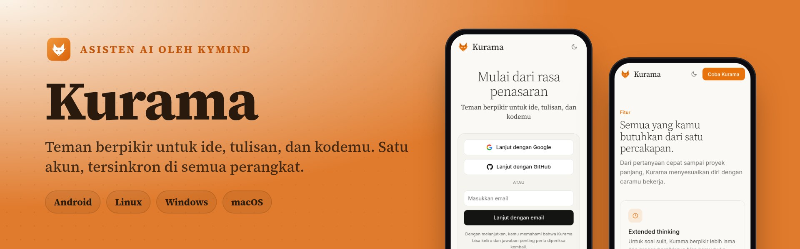
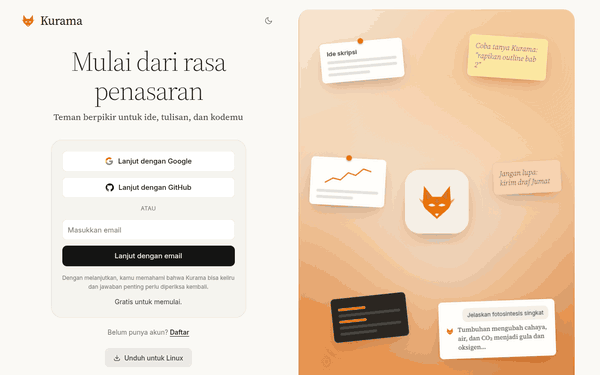
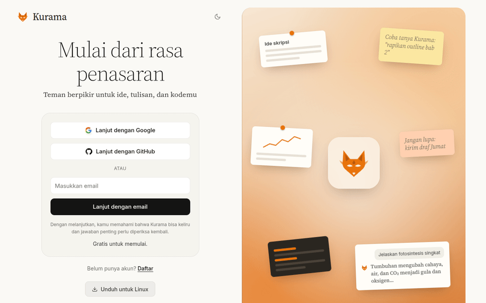
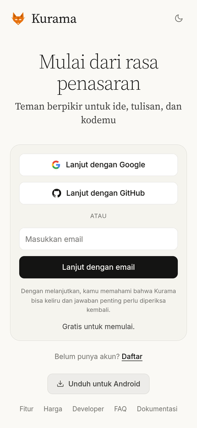
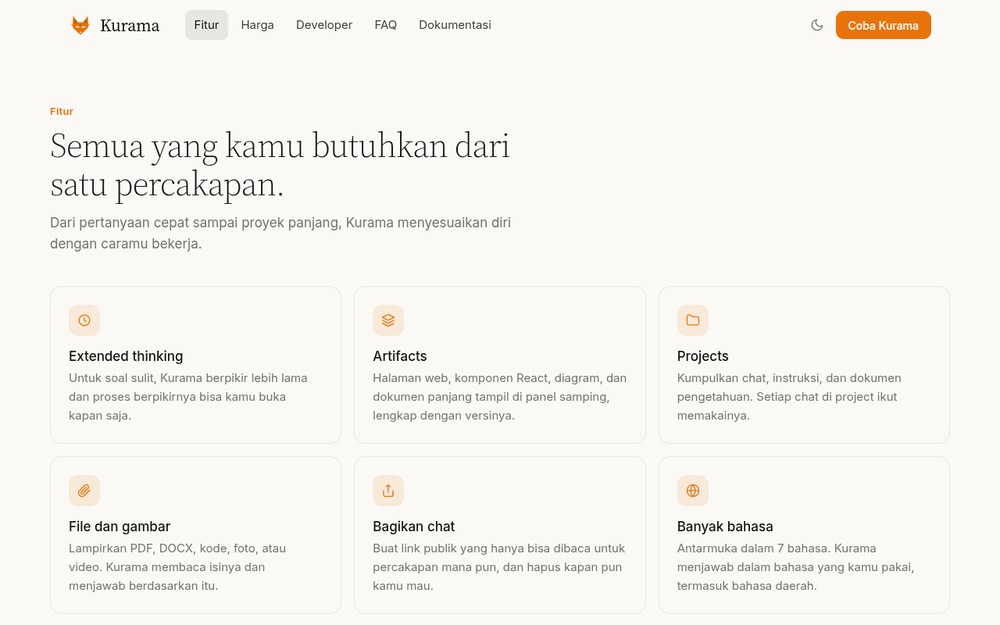
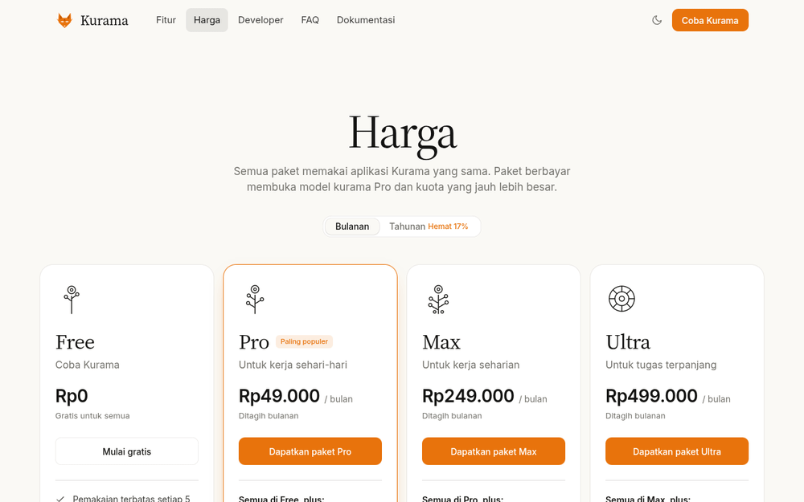
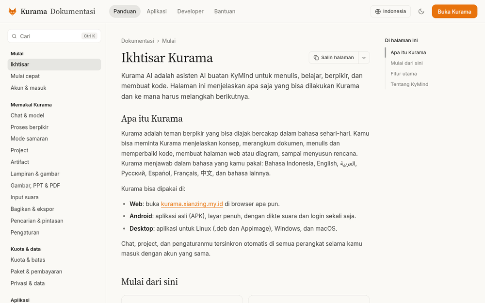

<p align="center">
  
</p>

<p align="center">
  <a href="https://kurama.xianzing.my.id"></a>
  <a href="https://github.com/ky-Mind/kurama-releases/releases/latest"></a>
</p>

<p align="center">
  
  
  
  
  
  
</p>

**Kurama** adalah teman berpikir untuk ide, tulisan, dan kode, dibuat oleh **KyMind**. Ajak Kurama bercakap dalam bahasa sehari-hari: menjelaskan konsep, merangkum dokumen, menulis dan memperbaiki kode, membuat halaman web atau diagram, sampai menyusun rencana. Bisa dipakai di browser, Android, Linux, Windows, dan macOS. Chat, project, dan pengaturanmu tersinkron otomatis selama kamu masuk dengan akun yang sama.

Repo ini berisi **berkas unduhan aplikasi** dan kode pembungkus aplikasi desktop. Situs: <https://kurama.xianzing.my.id>

## Sekilas

<p align="center">
  
</p>

<table>
  <tr>
    <td align="center" width="72%"><br><sub>Halaman masuk (desktop)</sub></td>
    <td align="center"><br><sub>Di layar HP</sub></td>
  </tr>
  <tr>
    <td align="center" colspan="2"> <br><sub>Fitur dan paket harga</sub></td>
  </tr>
  <tr>
    <td align="center" colspan="2"><br><sub>Dokumentasi berbahasa Indonesia</sub></td>
  </tr>
</table>

## Fitur utama

- **Dua model**: *kurama Mini* yang cepat dan hemat untuk tugas harian, *kurama Pro* untuk penalaran yang lebih dalam
- **Proses berpikir** (extended thinking): Kurama bisa berpikir lebih lama untuk soal sulit, dan prosesnya bisa kamu buka
- **Artifact**: halaman web, komponen React, SVG, diagram, dan dokumen panjang tampil di panel samping lengkap dengan versinya
- **Project**: kumpulkan chat, instruksi, dan dokumen pengetahuan dalam satu tempat
- **Lampiran**: kirim PDF, DOCX, kode, foto, atau video untuk dibaca Kurama
- **Gambar, PPT & PDF**: buat gambar, presentasi PowerPoint, dan dokumen PDF siap cetak
- **Mode samaran**: chat yang tidak masuk riwayat
- **Input suara**, **bagikan chat** lewat tautan baca-saja, dan **ekspor ke Markdown**
- **Banyak bahasa**: antarmuka dalam 7 bahasa, dan Kurama menjawab dalam bahasa yang kamu pakai

**Khusus aplikasi:** Android memakai aplikasi asli (layar penuh, login sekali, dikte suara, kamera, lembar bagikan Android). Aplikasi desktop berdiri sendiri tanpa Chrome, punya jendela sendiri, pintasan keyboard, halaman offline yang mencoba lagi otomatis, dan pengingat **Pembaruan Kurama tersedia** setiap ada versi baru.

## Unduh & pasang

| Perangkat | Unduh |
|---|---|
| Android | [Kurama-android.apk](https://github.com/ky-Mind/kurama-releases/releases/latest/download/Kurama-android.apk) |
| Debian / Ubuntu | [Kurama-linux-amd64.deb](https://github.com/ky-Mind/kurama-releases/releases/latest/download/Kurama-linux-amd64.deb) |
| Linux lain | [Kurama-linux-x86_64.AppImage](https://github.com/ky-Mind/kurama-releases/releases/latest/download/Kurama-linux-x86_64.AppImage) |
| Windows | [Kurama-windows-x64-setup.exe](https://github.com/ky-Mind/kurama-releases/releases/latest/download/Kurama-windows-x64-setup.exe) |
| macOS | [Kurama-macos.dmg](https://github.com/ky-Mind/kurama-releases/releases/latest/download/Kurama-macos.dmg) |

**Langsung di browser:** buka <https://kurama.xianzing.my.id>, lalu masuk dengan Google, GitHub, atau email. Gratis untuk memulai.

**Android** (7.0 atau lebih baru): buka berkas APK, ketuk **Pasang**. Bila diminta, izinkan pemasangan dari browser.

**Debian / Ubuntu:**

```bash
sudo apt install ./Kurama-linux-amd64.deb
```

Kurama muncul di menu aplikasi dan bisa dijalankan dengan perintah `kurama`.

**Linux lain (AppImage):**

```bash
chmod +x Kurama-linux-x86_64.AppImage
./Kurama-linux-x86_64.AppImage
```

**Windows:** jalankan `Kurama-windows-x64-setup.exe`. Bila muncul "Windows melindungi PC Anda", klik *Info selengkapnya* lalu *Tetap jalankan* (aplikasi belum bersertifikat penerbit berbayar).

**macOS:** buka `Kurama-macos.dmg`, seret Kurama ke Applications. Pertama kali dibuka: klik kanan Kurama lalu *Buka* (aplikasi belum dinotarisasi Apple).

**iPhone / iPad:** belum ada aplikasinya. Buka situs Kurama di Safari, ketuk **Bagikan**, lalu **Tambah ke Layar Utama**.

**Memperbarui:** aplikasi menampilkan pengingat **Pembaruan Kurama tersedia** saat ada versi baru. Pasang berkas versi baru di atas yang lama; chat, login, dan pengaturan tetap tersimpan.

## Kode aplikasi desktop

Folder `desktop/` berisi aplikasi Electron. Paket Windows dan macOS dibuat otomatis oleh GitHub Actions
(`.github/workflows/build-desktop.yml`) lalu dilampirkan ke rilis.

Dokumentasi lengkap pemakaian Kurama ada di <https://kurama.xianzing.my.id/docs>.

---

<p align="center"><sub>© KyMind · Dibuat oleh <a href="https://github.com/ky-Mind">ky-Mind</a> · <a href="https://kymind.web.id">kymind.web.id</a></sub></p>
